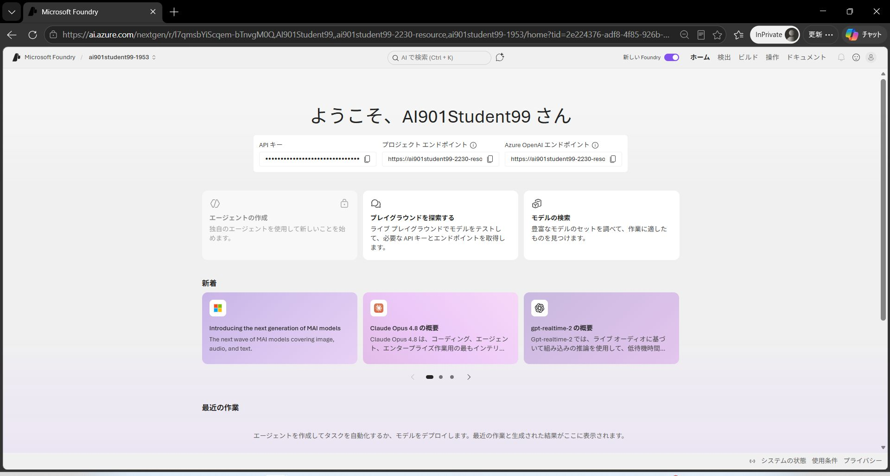

---
lab:
  title: 演習環境準備 - Microsoft Foundry プロジェクトの作成
  description: Microsoft Foundry プロジェクトを作成し、演習環境を準備します。
  level: 200
  duration: 10 minutes
  islab: true
  primarytopics:
    - Microsoft Foundry
---

# 演習環境準備: Microsoft Foundry プロジェクトの作成

この演習では、Microsoft Foundry プロジェクトを作成して演習環境を準備します。このプロジェクトは後続のすべての演習で使用します。

この演習の完了には約 **10** 分かかります。

> **注**: Microsoft Foundry ポータルを含む Microsoft Foundry の多くのコンポーネントは継続的に開発されています。これは人工知能技術の急速な進歩を反映しています。ユーザー エクスペリエンスの一部の要素が、この演習の画像や説明と異なる場合があります。

## Microsoft Foundry プロジェクトの作成

Microsoft Foundry は *プロジェクト* を使用して、AI ソリューションの開発に使用するモデル、リソース、データ、その他のアセットを整理します。プロジェクトは Azure の *Microsoft Foundry* リソースに関連付けられており、Azure 上での AI アプリとエージェント開発をサポートするために必要なクラウド サービスを提供します。

1. Web ブラウザーをInPrivateウィンドウ（シークレットウィンドウ）で開き、 [Azure Portal](https://portal.azure.com/)にアクセスします。

1. 資格情報の入力が求められます。講師から配布された研修用アカウントを使用してサインインを実施します。多要素認証(MFA)が求められた場合は指示に従ってデバイスの登録、デバイスを使用した追加認証を実施します。

1. サインイン完了後、画面上部の検索ボックスに **Microsoft Foundry** を入力して検索、結果に表示された同名のサービスをクリックします。

1. 画面左側に表示されるメニューから **> All models, agents & tools** を展開して、 **Microsoft Foundry** を選択します。

1. **+ 作成** のボタンをクリックして、 **Foundry リソースを作成する** の画面に移動し、**基本情報** タブで以下の内容を入力します。

    | 項目                 | 値                                                           |
    | -------------------- | ------------------------------------------------------------ |
    | サブスクリプション   | **従量課金**                                                 |
    | リソースグループ     | **AI901StudentXX** ※XXには研修用アカウントと同じ数字    |
    | 名前                 | **ai901studentXX-MMDD-resource** ※XXは研修用アカウントと同じ数字、MMDDは研修実施月日に置き換えてください |
    | リージョン           | **(US) East US**                                             |
    | Application insights | **None**                                                     |
    | Default project name | **AI901StudentXX-proj** （既定値を使用）                |

1. 入力が完了したら、 **確認と作成** 、 **作成** と続けてボタンをクリックしてFoundryリソースの作成を開始します。デプロイが進行し、完了するまで待ちます。

1. デプロイが完了したら、 **リソースに移動** をクリックして作成されたFoundryリソースを確認します。

1. 画面上部に表示される **↗Foundryポータルに移動** をクリックしてMicrosoft Foundryポータルへ移動します。資格情報の入力もしくは選択を求められた場合は、研修用アカウントの資格情報を入力もしくは選択して進めます。

1. 次の画像のようなページが表示されます。以降はこのMicrosoft Foundryポータルを使用していきます。

    

## まとめ

Microsoft Foundry プロジェクトの作成が完了しました。このプロジェクトは後続のすべての演習で使用します。次の演習に進んでください。
